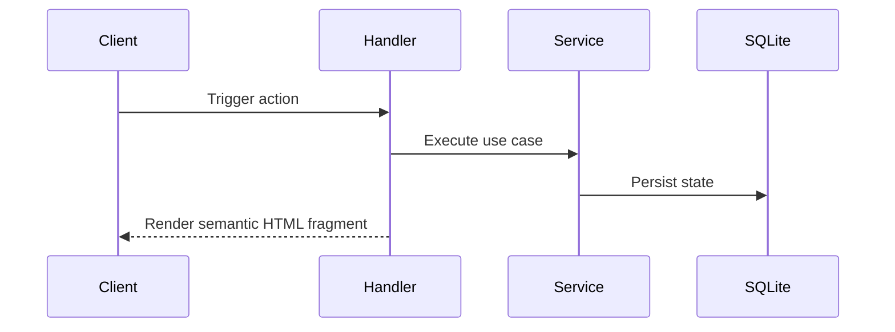

# Workflow: `[WorkflowName]`

- **Involved Services:** `application.[ServiceA]`, `application.[ServiceB]`
- **Involved Adapters:** `http`, `parsers`, `sqlite`, `sse`

---

## 1. Business Goal

End-to-end explanation of the multi-step flow.

## 2. Sequence Diagram

## 3. State Transitions & Rollback Rules

Detail state changes (`DRAFT` -> `QUEUED` -> `RUNNING` -> `COMPLETED` / `FAILED`) and recovery behavior on failure.
